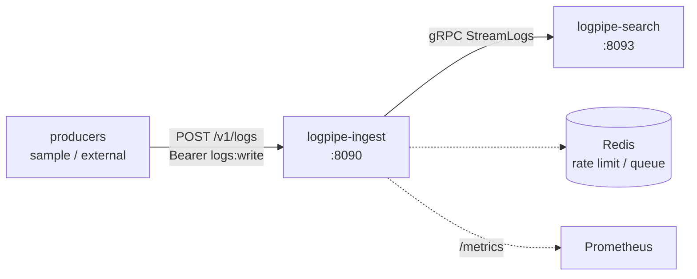

# logpipe-ingest

[](https://github.com/TiagoR85/logpipe-ingest/actions/workflows/ci.yml)
[](LICENSE)

Ingest tier of the logpipe family: accepts log batches over authenticated REST, validates them against the shared contract rules, batches them in-memory, and forwards to the search tier over gRPC. Also hosts the family's OAuth2/OIDC token endpoint (client credentials) and is itself a producer of its own structured JSON logs and OTel metrics.



## Status

Part of the logpipe family — see [logpipe-ui](https://github.com/TiagoR85/logpipe-ui) for the one-command demo (coming soon).

## Running tests

The contract package is fetched from its tagged source into a local feed **before** restore:

```powershell
pwsh ./scripts/fetch-contracts.ps1 -Ref v1.0.0
dotnet test tests/LogPipe.Ingest.Tests/LogPipe.Ingest.Tests.csproj -c Release
```

Tests use Testcontainers (Redis) — Docker must be running.

## Decisions

- [ADR-0004](docs/adr/ADR-0004-observability-baseline.md) — NLog JSON console + OTel Prometheus `/metrics`; trace ids flow as log data

## Roadmap

- OpenIddict issuer + scope-protected `POST /v1/logs`
- In-memory batching channel + rate limiting + gRPC forwarder
- Sample producer + compose wiring

## About this repository

This repository is part of a personal study project (the "github-portfolio-dotnet" portfolio). It was built with heavy use of AI-assisted development tools, but it is held to production standards on purpose: automated tests with a coverage gate, CI on every push, fail-fast configuration, structured logging, and honest documentation of trade-offs. It is not affiliated with any employer or client.

## License

MIT — see [LICENSE](LICENSE).
